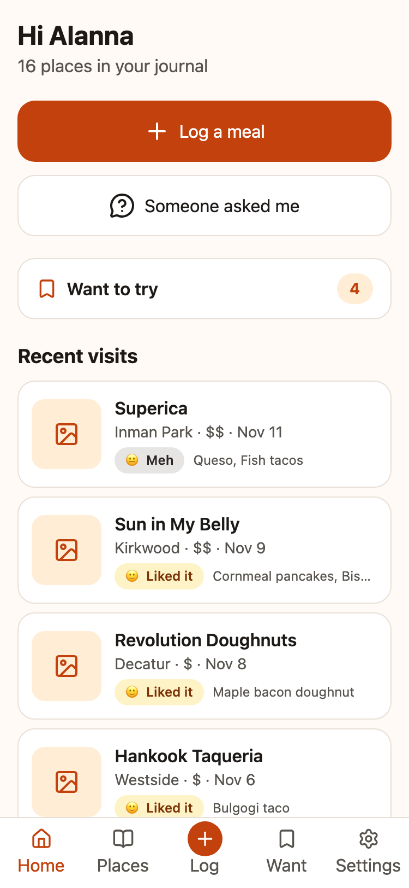
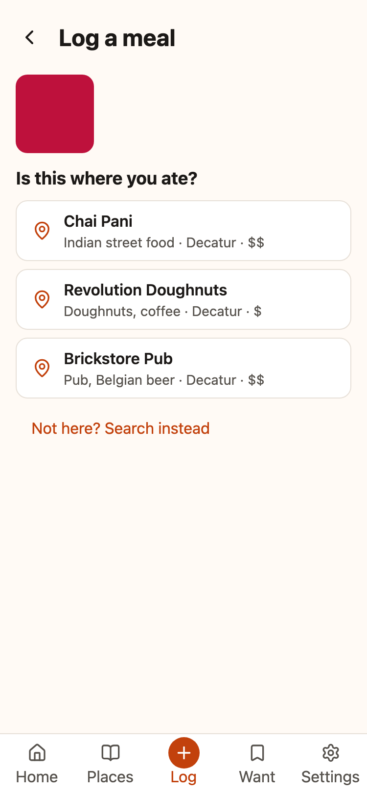
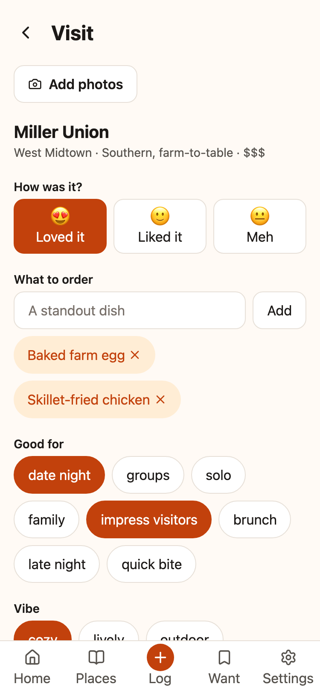
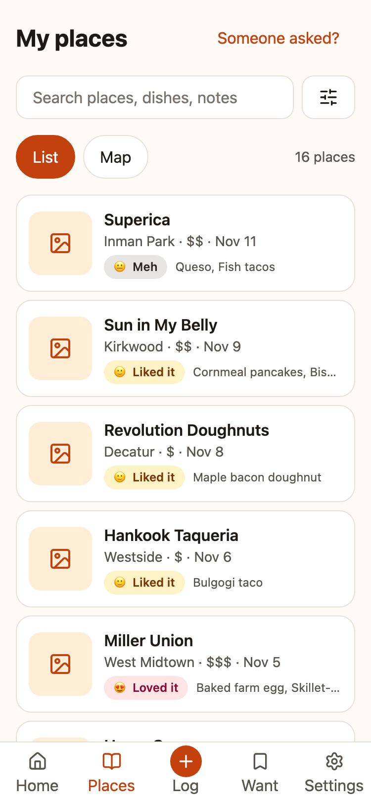
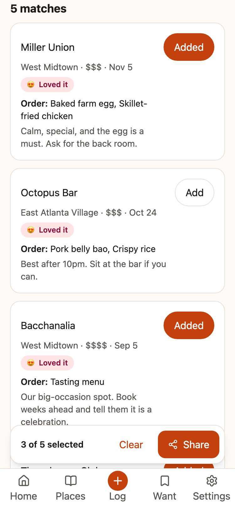
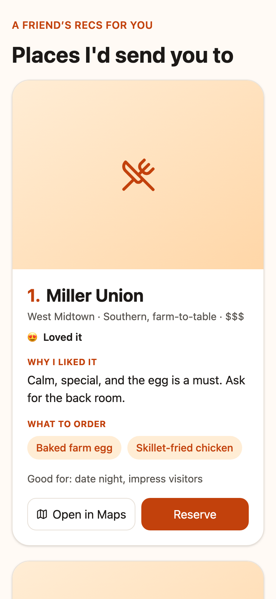

<p align="center">
  
</p>

# Recd

**Remember every restaurant you've been to, and turn that memory into a great rec for a friend in seconds.**

A mobile-first PWA built with React, Vite and TypeScript, backed by Supabase (Auth, Postgres with row-level security, Storage). Log a meal in a few taps, add a photo and let its GPS find the restaurant, then answer "where should we eat?" with your own best-loved places. Without Supabase env vars it falls back to a browser-only demo mode (see `DECISIONS.md`).

## Screenshots

<table>
  <tr>
    <td align="center" width="33%"><br><sub><b>Home</b><br>One big button to log, one to recommend</sub></td>
    <td align="center" width="33%"><br><sub><b>Photo-first logging</b><br>The photo's GPS suggests where you ate</sub></td>
    <td align="center" width="33%"><br><sub><b>Visit details</b><br>Feeling, what to order, occasion and vibe. Autosaves</sub></td>
  </tr>
  <tr>
    <td align="center" width="33%"><br><sub><b>My places</b><br>Search names, dishes and notes, filter by context</sub></td>
    <td align="center" width="33%"><br><sub><b>Someone asked me</b><br>Best-loved, most recent matches for any occasion</sub></td>
    <td align="center" width="33%"><br><sub><b>Shareable rec card</b><br>A friend opens it with no account</sub></td>
  </tr>
</table>

<sub>Screenshots are from the browser-only demo mode with sample Atlanta data. Regenerate them with `npm run dev:demo` and the steps in `docs/images/README.md`.</sub>

## Run it

Requires Node 20+.

```bash
npm install
cp .env.example .env.local   # then fill in your Supabase URL and publishable key
npm run dev
```

Open http://localhost:5173, tap **Create account**, and sign up with an email and a password (8+ characters). Once signed in, **Home > Load demo data** (or Settings) fills your journal with 16 sample Atlanta visits.

**No Supabase configured?** Leave `.env.local` empty (or set `VITE_DATA_BACKEND=local`) and the app runs entirely in your browser with fixture data: accounts are stored only in your browser (not secure, for demos and tests), and the sign-in screen gets a "Try the demo journal" button.

**Demo mode on its own port:** `npm run dev:demo` serves the browser-only version at http://localhost:5174 (separate from your Supabase-backed dev server), handy for screenshots and design handoff.

### Supabase setup (one time)

1. Apply `supabase/migrations/*.sql` in order (SQL editor, `supabase db push`, or the MCP `apply_migration` tool). They create the tables, row-level security, the private `visit-photos` bucket, helper functions and seed 41 places + 11 tags.
2. **Authentication > Sign In / Providers > Email** must be enabled (it is by default). With **Confirm email** off, new accounts sign straight in; with it on, the app shows a "Confirm your email" screen and the link must be allowed under **Authentication > URL Configuration > Redirect URLs** (add `http://localhost:5173/**` and your deployed URL). The built-in mailer is heavily rate limited, so add custom SMTP before turning confirmation on for real users.
3. There is no "forgot password" flow yet.

## Scripts

| Command | What it does |
|---|---|
| `npm run dev` | Dev server |
| `npm run build` / `npm run preview` | Production build / serve it on :4173 |
| `npm test` | Unit tests (Vitest): recs ordering, filters, EXIF-to-place matching, share payloads |
| `npm run test:e2e` | Playwright at 375px (always runs in local mode, no Supabase needed): log a visit, photo GPS/no-GPS, convert want-to-try, find a rec, logged-out share link, layout, a11y (axe), PWA |
| `npm run lint` | oxlint |
| `npx tsx scripts/make-fixture-photos.ts` | Regenerate the EXIF test photos |
| `npx tsx scripts/make-icons.ts` | Regenerate placeholder PWA icons |

First time running e2e: `npx playwright install chromium`.

## What's in the app

- **Quick log**: search a place (3 taps from the log screen, only the restaurant is required) or add 1-5 photos. Photo GPS and date are read with `exifr` and the top 3 nearby places are suggested; no GPS falls back to search.
- **My places**: list or map, filters (occasion, vibe, price, neighborhood, feeling, recommendable only) and search across names, dishes and notes.
- **Want to try**: save by search or by pasting an Instagram, TikTok or Maps link; one tap turns it into a visit.
- **Someone asked me**: pick up to 3 constraints, get your best-loved most-recent matches, share up to 5 as one card.
- **Share rec**: public `/r/:slug` card, no account needed.
- **Settings**: profile, export JSON, demo data, sign out.
- Photo "nudge" banner for photos you picked but never logged.

## Project layout

```
src/data/services.ts     contracts the UI depends on (swap point for Supabase)
src/data/local/          localStorage + IndexedDB implementations (demo / test mode)
src/data/fixtures/       Atlanta places, tags, demo seed
src/lib/                 pure logic: recs, filters, exif, share, geo
src/pages, components/   UI
e2e/, tests/unit/        tests
```

## Backend

```
supabase/migrations/   schema, RLS + storage policies, functions, seed data (apply in order)
supabase/tests/rls.sql        two users must never see or change each other's rows (+ logged-out visitor checks)
supabase/tests/functions.sql  signup trigger, update_visit, convert_want, constraints, delete behaviour
src/data/supabase/     implementations of the interfaces in src/data/services.ts
```

Run the two SQL tests in the Supabase SQL editor. Each ends by raising `RLS_TESTS_PASSED (N checks)` / `FUNCTIONAL_TESTS_PASSED (N checks)` on purpose so everything they create is rolled back; any other message names the failing check.

Still to do: password reset, Google Places via a server-side function (key must not ship in the browser), real Open Graph images for `/r/:slug` (crawlers don't run JavaScript), and a Playwright run against a real Supabase test project.

## Deploy (static)

Any static host works. Set `VITE_SUPABASE_URL` and `VITE_SUPABASE_PUBLISHABLE_KEY` in the host's environment (they are public, browser-safe values) and add the deployed URL to Supabase **Redirect URLs**. On Vercel: framework preset **Vite**, build `npm run build`, output `dist`, plus a rewrite of all paths to `/index.html` for client routing:

```json
{ "rewrites": [{ "source": "/(.*)", "destination": "/index.html" }] }
```

That rewrite is already in `vercel.json`.
